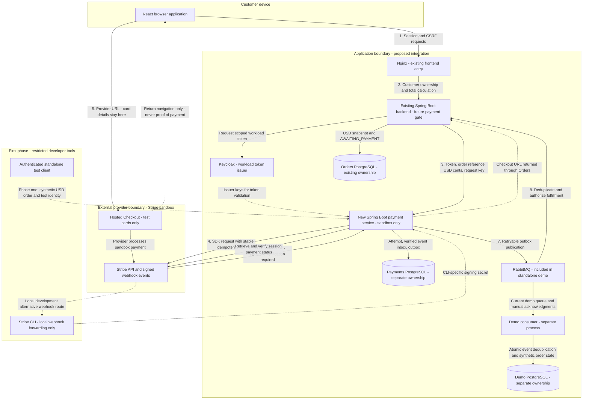
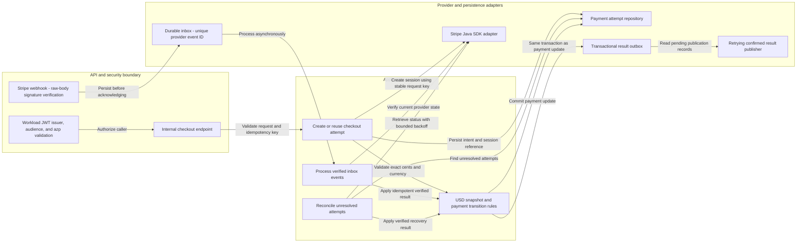

# Architecture Diagram

Target architecture for the USD payment POC. The standalone payment service, RabbitMQ topology, outbox, and isolated demo consumer are implemented; the coffee backend's payment integration remains proposed. All local services are declared in the root Compose file. Genuine Stripe sandbox access is still needed for interactive Checkout; no real money or settlement is in scope.

## Application Architecture

<!-- mermaid-checked: no \n, no em-dash/en-dash, no {} in labels, subgraphs are id["label"], arrows are -->|"label"|, all subgraphs closed by end, ids unique -->

Numbered arrows describe the later integrated target. The direct broker-to-Orders arrow is future work; the demo consumer is the current result subscriber. Dotted arrows denote return, discovery, or local-development paths, not weaker security. The standalone demo uses the test client and Stripe CLI instead of changing Orders or the frontend. Public deployed webhooks and local CLI forwarding are alternative delivery paths.

### Technology Stack Summary

| Layer | Technology | Version | Purpose |
| --- | --- | --- | --- |
| Existing UI | React and Nginx | Existing app versions | Customer order/status UI; later redirects to hosted checkout |
| Existing backend | Java and Spring Boot | Existing app versions | Authoritative USD totals, ownership, payment-gated fulfillment |
| New payment service | Java and Spring Boot | Java 25 and Boot 4.1.1 | Independently deployable payment orchestration |
| Provider adapter | Official Stripe Java SDK | SDK 33.0.0; API 2026-05-27.dahlia | Create sandbox Checkout Sessions and verify provider state |
| Persistence | Separate PostgreSQL databases | PostgreSQL 18 local images | Payment attempts/inbox/outbox and separate demo order state |
| Identity | Keycloak client credentials and Spring Security | Existing identity provider; dedicated service client | Validate workload token issuer, audience, and exact authorized party (`azp`) |
| Messaging | RabbitMQ | 4.2 management image | Implemented demo delivery; future independent Orders queue |
| Local testing | Stripe CLI and test cards | Pin during setup | Forward webhooks and exercise sandbox outcomes |

### Data Storage & External Services

Orders, Payments, and the demo consumer never share tables or database credentials. Payments persists its expected USD amount, provider references, unique incoming event IDs, and outbox records. Stripe stores card/payment details; our application must not collect card numbers or CVCs. RabbitMQ is part of the standalone demo and routes results to the independent consumer database. Future Orders will use its own queue and idempotent consumer.

### Key Architectural Decisions

- USD only: exact integer cents at the provider boundary, calculated from server-owned prices. No currency conversion, live keys, live-mode events, or real settlement.
- Two independent authentication boundaries: workload JWT authorization for internal APIs, raw-body Stripe signature verification for the dedicated webhook. No browser session requirement on that webhook alone.
- Verified payment state gates fulfillment. A redirect, failed card attempt, browser cancellation, duplicate event, or broker outage must not independently trigger preparation.

## Component Relationships

These responsibilities now map to the standalone service's implementation; Orders integration is still future work. Stripe-specific SDK types stay behind the provider adapter; the domain owns normalized payment state.

<!-- mermaid-checked: no \n, no em-dash/en-dash, no {} in labels, subgraphs are id["label"], arrows are -->|"label"|, all subgraphs closed by end, ids unique -->

### Component Inventory

| Component | Layer | Type | Responsibility |
| --- | --- | --- | --- |
| Internal authorization | `configuration/` | Security configuration | Validate JWT issuer, audience, exact azp, and restricted demo identity |
| Checkout endpoint | `api/` | Internal HTTP boundary | Validate input; never trust a public browser-supplied charge amount |
| Webhook endpoint | `api/` | Provider HTTP boundary | Verify signature/timestamp and sandbox context, then durably store event |
| Checkout use case | `application/` | Orchestrator | Persist intent; call provider outside database transaction; recover timeouts |
| Event and reconciliation workers | `application/` | Background processors | Verify provider status; recover lost/delayed events without duplicate charges |
| State rules | `domain/` | Business model | Enforce USD snapshot, valid transitions, and success not regressing |
| Stripe adapter | `provider/stripe/` | Provider adapter | Contain SDK calls, DTO mapping, status retrieval, and sandbox checks |
| Attempt repository and inbox | `persistence/` | Storage adapters | Enforce request/provider uniqueness and persist attempt/event records |
| Outbox storage and publisher | `persistence/` and `messaging/` | Reliable event integration | Atomically store result; retry publication with stable event ID |

## Build Boundaries

1. **Standalone sandbox:** implemented payment API with restricted test identity, database, Stripe adapter, signed webhook inbox, state transitions, reconciliation, outbox publisher, RabbitMQ, and demo consumer with its own database. Automated infrastructure tests mock Stripe; genuine interactive provider testing remains credential-dependent.
2. **Order integration:** finalize API/event contracts; add the backend-owned RabbitMQ queue/consumer and order-side deduplication; gate preparation/email on verified payment; add browser redirect/status UI.
3. **Outside this POC:** live merchant eligibility, real USD settlement, mobile money, refunds/disputes, and production compliance. None is implied by sandbox success.

See the [payment architecture specification](../../../../../payment-service/docs/architecture.md), [communication guide](../../../../../payment-service/docs/communication.md), and [quickstart](../../../../../payment-service/README.md). The guides distinguish implemented behavior from production hardening, Keycloak integration, and future coffee-backend changes.