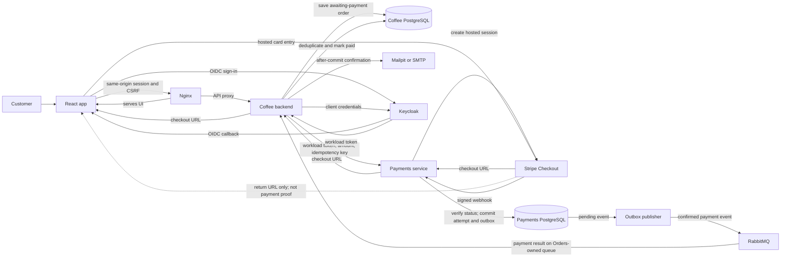

# Coffee Shop

Coffee Shop is a React and Spring Boot app for browsing coffee, ordering, and tracking pickup or delivery. PostgreSQL stores application data; paid orders are confirmed through Stripe-hosted Checkout before fulfillment.

## Demo

Watch the [Coffee Shop demo video](docs/demo-video.mov) (QuickTime, 128 MB).

## Architecture

The browser reaches the API through Nginx. The backend owns order totals and state; Payments owns Stripe interactions and publishes verified results through RabbitMQ.
# Coffee Shop

Coffee Shop is a React and Spring Boot app for browsing coffee, ordering, and tracking pickup or delivery. PostgreSQL stores application data; paid orders are confirmed through Stripe-hosted Checkout before fulfillment.

## Demo

Watch the [Coffee Shop demo video](docs/demo-video.mov) (QuickTime, 128 MB).

## Architecture

Nginx serves the React app and proxies API requests to the coffee backend. The backend owns order totals and state; Payments owns Stripe interactions and publishes verified results asynchronously.



See the [application flow](docs/architecture/application-flow.svg), [customer journey](docs/architecture/customer-journey.svg), and [payment communication guide](payment-service/docs/communication.md).

## Technology Choices

| Technology | Role and rationale | Alternatives |
| --- | --- | --- |
| React, TypeScript, Vite | Typed customer/admin UI with a quick build loop. | Vue, Angular. |
| Java, Spring Boot | API, security, order rules, and payment integration. | Quarkus, Micronaut. |
| PostgreSQL, Flyway | Relational transactions and versioned schema changes; each service owns its data. | MySQL/MariaDB, Liquibase. |
| Keycloak, OpenID Connect | Optional local SSO and workload identity using standard OIDC. | Entra ID, Auth0, Okta. |
| RabbitMQ | Durable asynchronous payment events with routing, acknowledgements, and retries. | Azure Service Bus, Kafka. |
| Stripe Checkout | Hosted card entry keeps card data out of this app. | Adyen, Braintree, PayPal, subject to availability. |
| Nginx, Mailpit | Same-origin proxy and safe local email capture. | Caddy/Traefik; smtp4dev or hosted SMTP. |

## Run Locally

Prerequisites: Docker Compose, Java 25, Maven, Node.js 26, and npm.

```sh
cd backend
./mvnw package -DskipTests
cd ..
docker compose up --build --detach
```

Open `http://localhost:8088`. For integrated Keycloak, Stripe sandbox, RabbitMQ, and Mailpit setup, see [docs/keycloak.md](docs/keycloak.md) and the [Stripe sandbox guide](payment-service/docs/stripe-sandbox.md). Stop with `docker compose down`; add `--volumes` only to delete local database data.

## CI/CD

GitLab is the source of truth. GitLab CI validates and publishes changed components; GitHub Actions verifies changes. The manual GitLab-to-GitHub sync is documented in [docs/github-sync.md](docs/github-sync.md).
