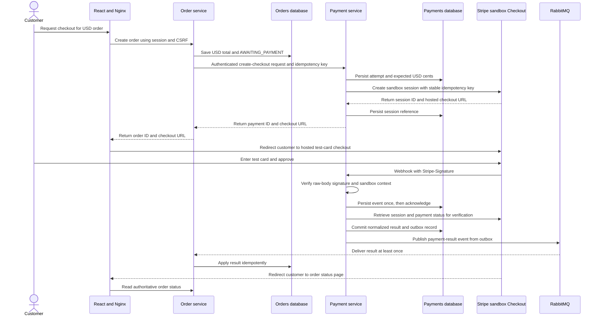

# Payment Service Architecture

## Architecture Diagrams

Start with the [application and component diagrams](../../.github/modernize/assessment/engines/facts/architecture-diagram.md). They show the security boundaries and separate data ownership. The sequence below describes the implemented local checkout flow; production deployment remains a separate concern.

## Status and Scope

The service is implemented with Spring Boot 4.1.1, Java 25, Stripe Java SDK 33.0.0 (API `2026-05-27.dahlia`), JDBC/Flyway, RabbitMQ, and a separately run demo consumer. The root Compose file owns all local services. Coffee checkout is integrated: the backend creates a pending order, requests hosted Checkout, and waits for a verified payment result before enabling fulfillment. See [communication.md](communication.md) for working contracts, local-only simplifications, and remaining production work.

The POC demonstrates one-time USD payments through Stripe sandbox hosted Checkout using Java and Spring Boot. Local sandbox access is verified; no real funds are collected or settled. Live processing, MTN Mobile Money, Orange Money, subscriptions, saved cards, refunds, payouts, and currency conversion are outside this increment.

This supersedes the earlier Fapshi/XAF direction. Sandbox access does not establish live merchant eligibility or USD settlement support in Cameroon. Production requires separate verification of merchant country, business onboarding, collection currencies, and settlement support.

## Service Ownership

The payment service owns payment attempts, Checkout Session and PaymentIntent references, normalized payment state, verified provider events, and an outbox. Use the official Stripe Java SDK behind the provider adapter; application/domain contracts must not expose SDK-specific objects.

The order service remains responsible for customer authorization, catalog prices, order totals, and fulfillment. Each service owns its own database; neither reads or writes the other's tables. The order backend calls Payments through the authenticated checkout API and consumes results through its own queue.

The browser calls Orders through the existing session/CSRF boundary. Only Payments holds Stripe secret credentials. Internal checkout creation requires an authenticated order-service workload, not a forwarded browser session. Keycloak client-credentials tokens are checked for signature, issuer, audience `payment-service`, expiry, and exact authorized party `azp=payment-service`; network isolation alone is not authentication.

## Money Contract

- Preserve USD pricing and include an explicit currency in order/payment contracts rather than inferring it from a dollar symbol.
- Convert the server-calculated decimal total to exact integer USD cents at the payment boundary: $3.00 becomes `amountMinor=300`, `currency=USD`. The adapter maps currency to Stripe's required representation.
- Use exact decimal arithmetic. Reject fractional cents, overflow, unsupported currencies, and amounts below the provider's applicable minimum; do not silently round or calculate charges using binary floating point.
- Persist an immutable amount/currency snapshot per attempt and include it in result events. The browser cannot supply authoritative amounts or arbitrary provider price identifiers.
- Pricing, charge, and settlement currencies are distinct. This POC demonstrates sandbox USD pricing/charges only, with no real settlement or exchange-rate policy.

## Integrated Flow

The redirect and webhook may arrive in either order. Display payment pending until Orders has applied a verified result. Never mark paid based on a return URL.

## State and Consistency

- Orders begin in `AWAITING_PAYMENT`; the backend transitions them to `PAID` only after validating a payment-result event. Preparation and the order-confirmation email wait for that verified transition.
- RabbitMQ and the isolated demo consumer are included alongside the backend-owned payment-result queue used by coffee checkout.
- Payment attempt states are proposed as `PENDING`, `SUCCEEDED`, `FAILED`, and `EXPIRED`, separate from fulfillment. A declined card can be retried within an open session, so a failed card attempt is not necessarily terminal payment failure.
- Canceling checkout or closing the browser is not proof of payment cancellation/failure. Reuse an open session or explicitly expire it and verify the outcome before creating a replacement attempt.
- Deduplicate initiation requests using an internal idempotency key and a matching order/amount/currency snapshot; reject key reuse with a changed request. Pass a stable attempt-specific key to Stripe. On timeout, reconcile/retry the same attempt instead of creating another potential charge.
- Persist intent before the external call, without holding a database transaction open across HTTP requests. Recover a crash between session creation and local persistence using the stored attempt and stable provider idempotency key.
- Verify webhook signatures first, then persist events with a unique provider event ID before acknowledging. Return a retryable error if durable receipt fails. Process asynchronously and handle duplicate/out-of-order delivery without regressing `SUCCEEDED`.
- For initial test cards, checkout completion is accepted only after verified paid status, expected amount/currency, and references match. Delayed payment methods are disabled; enabling them later requires asynchronous success/failure handling.
- Commit the payment transition and outbox event atomically; publish with retries. Consumers deduplicate by event ID and validate the expected payment attempt and USD snapshot before changing an order.
- Reconcile unresolved sessions with bounded backoff and rate-limit handling. Define checkout expiration and late-success handling before linking fulfillment; do not silently discard a late payment or fulfill twice.

## Security

- Use sandbox credentials and test cards only. Reject live credentials in sandbox configuration and reject provider objects/events with `livemode=true`; key-prefix checks alone are insufficient.
- Keep Stripe secret keys and webhook signing secrets in secret storage or ignored local configuration, never source, frontend bundles, images, or logs. Use least-privilege credentials where supported and separate environments.
- Verify `Stripe-Signature` with the official SDK, endpoint-specific signing secret, timestamp tolerance, and exact raw request bytes before processing. Invalid or stale signatures must not change payment state.
- Exempt only the dedicated webhook route from browser CSRF/session requirements; authenticate it using signature verification. Keep internal payment APIs authenticated and authorized.
- Use HTTPS for a deployed sandbox webhook. For local development, use Stripe CLI forwarding with its own signing secret, distinct from the deployed endpoint secret.
- Validate provider account/context, session/payment reference, paid status, order/attempt reference, exact amount, and USD currency against persisted expectations. Quarantine unexpected values instead of marking success.
- Use server-owned success/cancel destinations and provider-created hosted checkout URLs, not arbitrary caller URLs. Do not allow callers to select provider API base URLs.
- Card numbers, CVCs, and payment authentication stay on Stripe-hosted Checkout; our services never collect or log them. Hosted checkout reduces exposure but does not establish production PCI compliance by itself.
- Enforce request-size limits, bounded timeouts, and rate limits that accommodate provider retries. Redact personal data, credentials, and sensitive payloads. Define retention and audit access for payment records.
- Use separate database credentials and least-privilege access per service. Customer ownership checks remain in Orders; the browser cannot choose another customer's order or charge amount.

## Standalone Demonstration

The standalone payment CLI remains available for exercising synthetic USD payments, webhook verification, the outbox, and demo consumer without creating a coffee order. In the integrated flow, the coffee backend calculates the order total and passes its order reference and amount to Payments; the browser never supplies an authoritative charge amount.

## Planned Verification

1. Successful sandbox payment produces one verified success and outbox event with the expected USD cents.
2. Declined test cards remain unpaid and can be retried without duplicate fulfillment.
3. Browser cancellation, closure, or a forged success URL never marks paid; verified expiration becomes `EXPIRED` only if unpaid.
4. Invalid/stale signatures, live-mode events, or mismatched amount/currency/reference never mark paid.
5. Duplicate/out-of-order webhooks, initiation timeouts, database outages, and broker outages recover without duplicate charges or lost results.
6. Future Orders integration gates preparation/email on verified success and handles multiple paid attempts or late payments through explicit reconciliation.

## Decisions Still Open

1. Confirm legitimate Stripe sandbox account access. Do not assume live merchant eligibility in Cameroon.
2. Select and pin Java, Spring Boot, Stripe Java SDK, and Stripe API versions when introducing the build; no dependency is installed yet.
3. Define internal endpoint/event schemas, service-token audience and authorized-party policy, session expiration, retry policy, and late-payment handling.
4. Confirm the standalone database, local webhook-forwarding setup, and later RabbitMQ/outbox deployment.
5. Review production onboarding, real USD settlement, refunds/disputes, and mobile-money support separately; they are not implied POC capabilities.

## Provider Documentation

- [Stripe-hosted Checkout](https://docs.stripe.com/payments/checkout)
- [Official Stripe Java SDK](https://github.com/stripe/stripe-java)
- [Stripe testing](https://docs.stripe.com/testing)
- [Webhooks](https://docs.stripe.com/webhooks)
- [Checkout fulfillment](https://docs.stripe.com/checkout/fulfillment)
- [Idempotent API requests](https://docs.stripe.com/api/idempotent_requests)
- [Merchant country availability](https://stripe.com/global)
