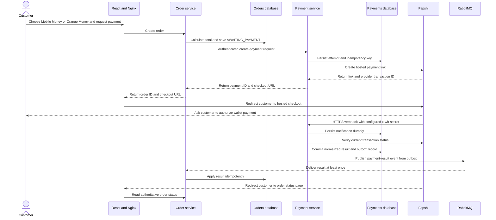

# Payment Service Architecture

## Status and Scope

This is a design artifact and directory skeleton, not a running service. The first increment is limited to collecting one-time customer payments for coffee orders using Cameroon mobile money. Card processing, stored wallets, subscriptions, split payments, and payouts are out of scope.

## Service Ownership

The payment service owns payment attempts, provider transaction references, normalized payment state, verified provider notifications, and an outbox. The existing order service remains the owner of orders, customer authorization, catalog prices, and fulfillment state. Each service gets its own database; neither service reads or writes the other's tables.

Only the payment service holds provider credentials. The browser never calls the provider API directly. The order service will be the trusted caller for checkout creation after it has authenticated the customer, checked order ownership, and calculated the amount.

## Proposed Flow

The hosted-checkout method-selection behavior must be confirmed in Fapshi's sandbox. Direct-pay is a fallback only if the hosted page cannot offer both methods; it has different lifecycle and retry risks.

## State and Consistency

- The order begins in `AWAITING_PAYMENT`; preparation must not begin yet.
- The payment service tracks a normalized attempt lifecycle such as `PENDING`, `SUCCEEDED`, `FAILED`, and `EXPIRED`.
- A provider notification is persisted before returning success to the provider. A background handler verifies its transaction through the provider API before recording a final result.
- The payment-result event is written to an outbox in the same database transaction as the payment-state update. RabbitMQ delivery is at least once, so the order consumer deduplicates by event ID and makes transitions idempotent.
- A reconciliation worker checks unresolved attempts to recover notifications that were lost. It must respect Fapshi's per-transaction status-query rate limit and use backoff.
- The browser redirect is only a navigation aid. It never marks an order paid.

## Security

- Expose no general payment-management endpoint to browsers. The future checkout-creation API is internal and accepts requests only from the authenticated order-service workload.
- The order service authenticates and authorizes the customer before creating an order. It supplies the order ID and server-calculated total; the browser cannot choose the amount or another customer's order ID.
- Keep Fapshi `apiuser` and `apikey` credentials in the payment service's secret store, separate for sandbox and production. Do not commit them, put them in frontend configuration, or log request headers.
- Publish the webhook only over HTTPS through a controlled ingress. Configure a dedicated webhook secret, compare it safely, enforce request-size and rate limits, and do not treat the shared-secret header alone as proof that the payment succeeded.
- Validate provider transaction ID, external order reference, amount, currency, payment method, and current provider-side status before finalizing a payment.
- Never collect wallet PINs or OTPs in this application. Do not store card data. Minimize and restrict access to payer phone numbers and provider payloads; redact them from logs.
- Separate database credentials and least-privilege access by service. Audit payment state changes and administrator refund actions if refunds are added later.

## Fapshi-Specific Constraints To Verify

Fapshi's current documentation describes MTN Mobile Money and Orange Money collections in Cameroon, a hosted `/initiate-pay` link with an XAF integer amount (minimum 100 XAF), separate sandbox/live credentials, and a webhook secret sent in `x-wh-secret`.

The webhook documentation says it sends one notification per event and does not retry when the receiver is unavailable. Therefore the design requires durable receipt plus status reconciliation; do not assume provider webhook retries. The status endpoint is rate-limited to six requests per minute per transaction, so reconciliation must be bounded and backed off. The `/direct-pay` flow does not expire and is disabled by default in live mode, which makes automatic retries unsafe until the prior attempt is known to be final.

Before production, confirm merchant activation, fee schedule, settlement timing, operational support, webhook source/IP guidance, and the exact wallet choices exposed by hosted checkout.

## Decisions Still Open

1. Confirm XAF as the catalog/order currency. The current coffee app formats prices as dollars, and its current totals cannot be sent unchanged to an XAF-only provider. Do not add an implicit exchange-rate conversion.
2. Verify that hosted checkout exposes both MTN Mobile Money and Orange Money in the Cameroon sandbox and live account.
3. Confirm the provider account and production onboarding requirements before storing live credentials.
4. Confirm RabbitMQ as the payment-result transport. It is the proposed first broker; the service still must remain correct under duplicate and delayed events.
5. Define payment expiry and retry rules, especially if direct-pay is required.

## Provider Documentation

- [Fapshi product overview](https://docs.fapshi.com/)
- [Hosted payment link](https://docs.fapshi.com/en/api-reference/endpoint/initiate-pay)
- [Direct pay](https://docs.fapshi.com/en/api-reference/endpoint/direct-pay)
- [Webhook integration](https://docs.fapshi.com/en/api-reference/endpoint/webhook)
- [Environment and sandbox](https://docs.fapshi.com/en/api-reference/preliminary-knowledge/environment)
- [Payment status and rate limit](https://docs.fapshi.com/en/api-reference/endpoint/payment-status)
